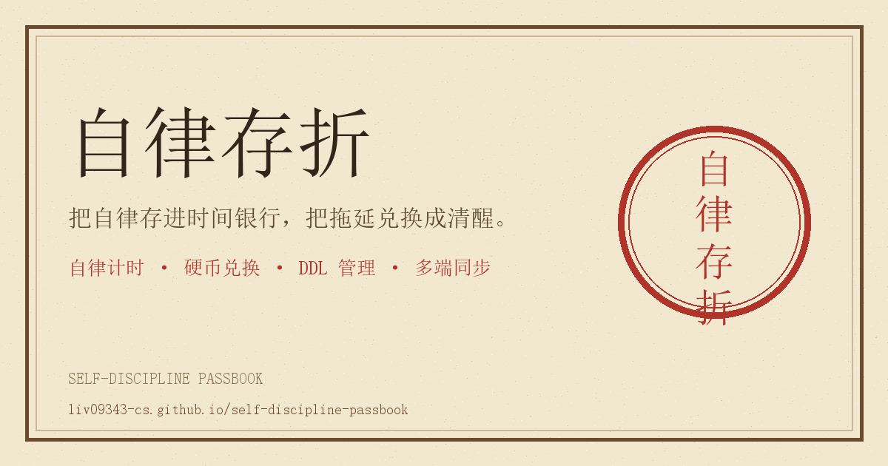

# 自律存折

面向大学生的自律计时与 DDL 管理应用。把专注时长存成硬币，用硬币兑换延迟满足；同时管理课程、考试与项目截止日期。

在线地址：<https://liv09343-cs.github.io/self-discipline-passbook/>

当前版本：**v1.2** · 版本更新说明见 [CHANGELOG.md](./CHANGELOG.md)



## 功能

- **自律计时**：自定义自律内容，开始 / 暂停 / 继续 / 结束，按小时汇率折算硬币，支持 0.1 枚精度
- **多账本**：每本存折独立管理自律项目、硬币余额、奖励、流水与 DDL
- **延迟满足兑换**：为奖励标价，余额不足自动禁用，兑换写入账目
- **DDL 管理**：手动录入或从截图 OCR 识读，月历标记，近期到期排序
- **到期提醒**：导出 `.ics` 交给系统日历，或在页面内开启浏览器通知
- **统计报表**：8 项指标、近 30 天专注热力、逐日专注明细
- **数据同步**：Supabase 邮箱登录、多端同步、备份文件与同步码离线迁移
- **PWA**：可安装到桌面，支持 Service Worker 离线打开

## 技术栈

- React 18 + Vite 5 + TypeScript
- Supabase（Auth + Postgres + RLS）
- tesseract.js（DDL 图片 OCR）
- 纯 CSS 设计系统（米色纸面 / 朱红 / 宋体 / 虚线账目栏 / 硬阴影）

## 本地运行

环境要求：Node.js 18+。

```bash
npm install
npm run dev
```

Windows 也可以直接双击 `start.bat`（项目内附带便携版 Node）。

生产构建：

```bash
npm run build
npm run preview
```

## Supabase 配置

1. 创建 Supabase 项目
2. 在 SQL Editor 执行 [`supabase/schema.sql`](./supabase/schema.sql)
3. 把 Project URL 与 Publishable key 写入 `public/supabase-config.json`
4. 在 Authentication → URL Configuration 中配置 Site URL 与 Redirect URLs

配置文件格式：

```json
{
  "url": "https://your-project.supabase.co",
  "key": "sb_publishable_xxx",
  "captchaSiteKey": ""
}
```

只使用 Publishable key，**不要**把 Secret key 放进前端。

`captchaSiteKey` 可选。在 Supabase 开启 Attack Protection 的 CAPTCHA 后，填入 Cloudflare Turnstile 的 Site Key，前端会自动渲染人机验证；Secret Key 只填在 Supabase 控制台。

防滥用建议：

- 保持邮箱确认开启
- 在 Authentication → Rate Limits 限制注册与发信频率
- 执行 `supabase/security-hardening.sql`，限制每用户 20 本存折、单本 512KB

## 部署

仓库已配置 GitHub Actions：

- push 到 `main` 自动构建并发布到 GitHub Pages
- 仓库 Settings → Pages → Source 选择 **GitHub Actions**
- 自定义域名或其他静态托管可直接上传 `dist/`

## 目录

```text
src/
  components/   页面与面板
  hooks/        计时、同步、通知
  lib/          日期、账本、统计、OCR、ICS、Supabase、备份
  store/        全局状态与种子数据
supabase/       建表与 RLS 脚本
public/         图标、manifest、Service Worker、404
```

## 已知限制

- 多端同步为账本级 last-write-wins，提供「以云端覆盖本机」兜底
- 计时状态不跨端同步，避免两端同时计时
- 浏览器通知需要页面打开；系统级关闭页面后的提醒请使用 `.ics`
- OCR 首次使用需要联网加载中文模型，失败时可粘贴文字解析